<!-- nsb-brand:v1 -->
<p align="center">
  
</p>

# `assets/animations/` — the physics animation set

> **Navigation:** [repository root](../../README.md) › [assets](../README.md) › **`animations`**


---

GitHub renders GIF files natively in Markdown, so this directory is the
repository's **moving-figure layer**: seven animations, each produced by
a real solver or an exact closed form, embedded in the root README and
in [`verification/README.md`](../../verification/README.md) so that the
physics can be *watched*, not just asserted.

| Animation | What you see | How it is produced |
|---|---|---|
| [`anim_b_rotation.gif`](anim_b_rotation.gif) | a vector field on a sphere rotated **stepwise by `θ_b` = 3.5765013°** about `ω̂ = ẑ`; the counter climbs one θ_b per frame while `max |‖u′‖ − ‖u‖|` stays at machine zero — the energy-neutrality statement made visible | the exact Rodrigues form, 40 steps, deterministic seed 20260916 |
| [`anim_kdv_collision.gif`](anim_kdv_collision.gif) | the **exact Hirota two-soliton collision** of the KdV equation: the tall and the shallow soliton approach, pass through each other, and separate with unchanged shapes and amplitudes | the closed form `u = 2 ∂²ₓ ln F`, 96 frames |
| [`anim_taylor_green.gif`](anim_taylor_green.gif) | the **2D Taylor–Green decay** — the symmetric vortex lattice dissolving under viscosity, colored by vorticity, with live `t` and `E` readouts | the repository's own [`code/tg2d_core.py`](../../verification/code/tg2d_core.py) pseudo-spectral solver (N = 96, ν = 10⁻³, RK4, 2/3-dealiasing, Leray projection) |
| [`anim_spectrum_cascade.gif`](anim_spectrum_cascade.gif) | the **angle-averaged spectrum `E(k, t)`** of the same run: the energy migrating downscale against the k⁻⁵ᐟ³ and k⁻³ reference lines | the shell spectrum of the same solver's frames |
| [`anim_rayleigh_benard.gif`](anim_rayleigh_benard.gif) | **Rayleigh–Bénard convection** at Gr·Pr = 7.1·10⁵: thermal plumes rising and falling, live `Nu_hot` readout growing past 8, CFL ≤ 0.187 | the registered P3 equations ([`code/p3_buoyancy.py`](../../verification/code/p3_buoyancy.py)): ψ–ω Boussinesq, free-slip, Nz = 144, dt = 1.5·10⁻⁶ |
| [`anim_vortex_filaments.gif`](anim_vortex_filaments.gif) | two vortex rings **leapfrogging through each other** along their axis: the rear ring contracts, the front one expands, they exchange places | segment Biot–Savart with a blob core ε² = ε₀² + 4νt, RK4 (the §27b machinery), 24 nodes per ring |
| [`anim_layered_braking.gif`](anim_layered_braking.gif) | the **layered braking model** (§27): twelve layer circulations Γᵢ decaying as dΓᵢ/dt = −bᵢΓᵢ/T, with the braking torque τ = −Σ bᵢΓᵢΔz and its log-decrement against mean(b) | the exact solution of the model the monolith's tasks 11–14 verify |
| [`anim_klein_orbit.gif`](anim_klein_orbit.gif) | the **Klein bridge**: the orbit {k·θ_b mod 2π} filling the circle uniformly, the gap classes collapsing to ≤ 3 (the three-gap theorem), the Weyl discrepancy D_k shrinking — monolith task 5 in one loop | the exact rotation by θ_b with Niven's irrationality; gaps and D_k computed per frame |

## Regenerating

One command rebuilds the entire set — deterministic seeds, self-checking
(frame counts, sizes, a non-blank-pixel assertion), a `JSON: {…}`
verdict and a non-zero exit on any failure:

```bash
python3 verification/scripts/make_animations.py             # all 8, ~2 min
python3 verification/scripts/make_animations.py --only rayleigh_benard
```

The generator lives in the verification framework
([`verification/scripts/make_animations.py`](../../verification/scripts/make_animations.py))
and imports the repository's own physics cores, so what you can watch is
what the verifiers check. Requires the scientific stack from
[`environment.yml`](../../environment.yml).

## Relation to the pinned protocols

The animations are *illustrative physics*, computed with the same
numerical ideas — and, for Taylor–Green and Rayleigh–Bénard, the same
solver code — as the pinned protocols, at visual-grade parameters where
noted. The repository is careful about the distinction: the auditable
numbers live in [`data/results/`](../../data/results/README.md) and
[`research_col_smar/results/`](../../research_col_smar/results/README.md);
these GIFs exist so a reader can *see* the mechanisms those numbers
describe.

## Technical notes

- Format: GIF89a via matplotlib's `PillowWriter`, 8–16 fps, loop
  forever; total set ≈ 7.2 MB, the heaviest file 2.4 MB.
- Deterministic: fixed seeds everywhere (`20260916`, solver seed 7) — a
  regeneration run reproduces the files bit-for-bit up to PNG/GIF
  encoder metadata.
- The static companion set is [`assets/figures/`](../figures/README.md);
  the brand headers are [`assets/brand/`](../brand/README.md).

## License

Part of **navier-stokes-b**, license IPL-RP-1.0 ([LICENSE.md](../../LICENSE.md)).
