# `assets/brand/` — The Animated Brand Kit (SVG)

> **Navigation:** [repository root](../../README.md) › [assets](../README.md) › **`brand`**


The animated visual identity of the repository: a self-contained set of
**26 standalone animated SVGs** in the "scientific premium" style. Every
file is a single self-rendering document — the motion is CSS-keyframe-based
and lives inside the file itself, so GitHub renders the animations natively
in READMEs, the Pages site and any Markdown viewer, with zero JavaScript
and zero external assets. All artwork shares one palette (deep navy
`#0A0E1A`, electric cyan `#00E5FF`, warm amber `#F59E0B`, violet `#A855F7`)
and one visual language: blueprint grids, volumetric glow, flowing
streamlines and mathematical glyph work.

## Contents

| Group | Files | Shows |
|---|---|---|
| Hero | `hero_animated.svg` | turbulent chaos resolving into ordered vortex rings; the constants strip |
| Identity | `logo_animated.svg`, `avatar_animated.svg` | rotating vortex + `b` monogram (512×512, rounded / circular) |
| Section headers | `header_*.svg` (15) | one animated miniature scene per README topic — verification matrix, eleven lanes, NSB-96 scoreboard, KdV solitons, fluid lab, evidence layer, monographs, research lab, papers, satellites, output contract, sections 1–7 |
| Diagrams | `chaos_order_animated.svg`, `pipeline_animated.svg`, `lanes11_animated.svg`, `b_dial_animated.svg`, `scoreboard_animated.svg`, `spectrum_animated.svg`, `kdv_collision_animated.svg`, `fluid_vortex_animated.svg` | the program's core stories as seamless loops: chaos→order, the seven-module pipeline, the 11-language convergence, the θ_b rotation dial, the lab scoreboard, the spectral slopes, the two-soliton collision, vortex merging |

## Design tokens

- Background: `#0A0E1A` → `#0D1117` gradients, blueprint grid `#16233F` / `#1E2A44`
- Accent 1 (flow, rotation, b-effect): `#00E5FF`, `#22D3EE`
- Accent 2 (proof, constants, stability): `#F59E0B`, `#FBBF24`
- Accent 3 (anomaly, contrast): `#A855F7`
- Type: monospace stack (`JetBrains Mono`, `Cascadia Code`, `Consolas`, `Menlo`)

## Usage

Reference any file relatively from a README — the animated header of each
directory README is exactly that. To embed elsewhere:

```markdown

```

The files are pure SVG 1.1 + embedded CSS; no scripts, no external fonts,
no raster payloads (each file is 6–63 KB). They scale losslessly from
favicon to full-width banner.
