<!-- nsb-brand:v1 -->
<p align="center">
  
</p>

# `monograph/open-problems/` — the P1–P7 Package

> **Navigation:** [`monograph`](../README.md) › **`open-problems`**


 

The open-problems package of the b = 1/(4π + 2√3) program. Master document:
[`OPEN_PROBLEMS_7.md`](OPEN_PROBLEMS_7.md) (bilingual RU/EN). Every number
comes from real runs of **2026-09-16** — scripts in [`code/`](code/README.md),
raw results in [`results/`](results/README.md) (JSON), figures in
[`figures/`](figures/README.md). Provenance and honesty rules are §0 of the
master document; the program's rule is that **both outcomes count as
results** — a measured effect or a strict bound — and which one was
obtained is recorded explicitly.

**Status: fully executed and closed.** Every row of the status table
(§1 of the master document) is RUN ✓ — the base seven plus the extension
line P1-b / P4-b / P4-c / P5-b / P5-c, all folded into this same
package. The full chain was re-run on 2026-11-11: all nine steps PASS
and every regenerated JSON is byte-identical to the pinned one (fixed
seeds, no timestamps in the outputs).

## Layout

| Item | Contents |
|---|---|
| [`OPEN_PROBLEMS_7.md`](OPEN_PROBLEMS_7.md) | the master document: statement → plan → criteria → outcome, for each of P1–P7 |
| [`code/`](code/README.md) | the runnable scripts (fixed seeds), one per problem + the aggregator |
| [`results/`](results/README.md) | the JSON protocols — every number of the master document |
| [`figures/`](figures/README.md) | the figures generated from the JSONs |

## One command

```bash
python3 code/run_all.py       # runs everything, ~10 min, regenerates the JSONs
python3 code/make_figures.py  # regenerates the figures from the JSONs
```

Related packages: the earlier standalone −b runs (P4b T = 8 with its
fine 8-seed chain, P5b duplex pair, executed 2026-09-15) stay pinned in
[`open-problems-b/`](../open-problems-b/README.md); the mechanism-level
twin of this program — the same b-claims re-derived by the independent
verification framework — lives in [`verification/`](../../verification/README.md)
with its runs pinned under [`data/results/`](../../data/results/README.md).

---

---

Navigation: [repository root](../../README.md) · [monograph](../README.md) · [data/results](../../data/results/README.md) · [IPL-RP-1.0](../../LICENSE.md)

*Part of [wild8highlander/navier-stokes-b](https://github.com/wild8highlander/navier-stokes-b) - (c) 2026 Isaev Iskhak Khamzatovich, all rights reserved.*

