<!-- nsb-brand:v1 -->

  

# Display formulas (300 dpi PNG, matplotlib mathtext)

Rendered by `code/python/make_formulas.py`; shared by the RU and EN
editions (formulas are language-independent). Regenerate with
`python3 code/python/make_formulas.py`.
