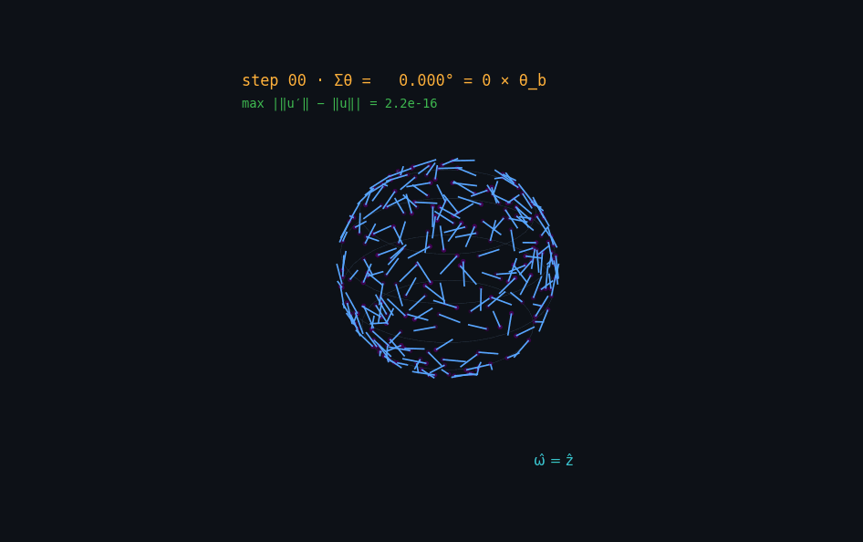
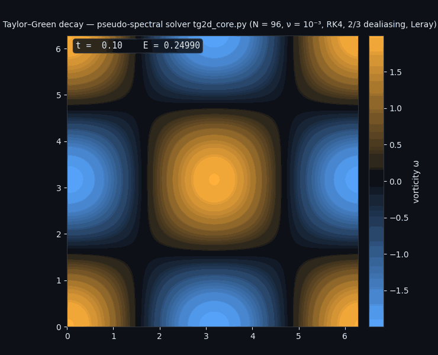
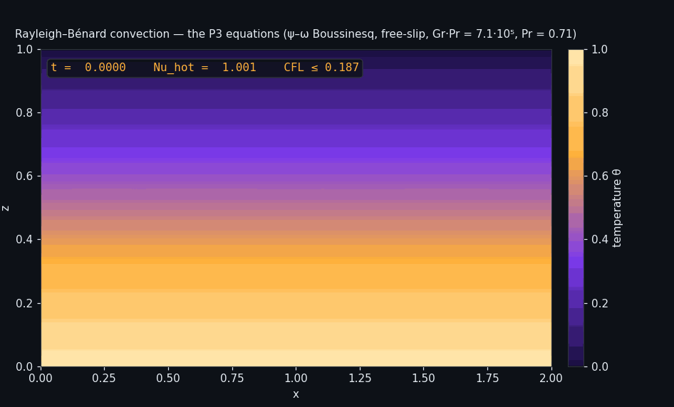
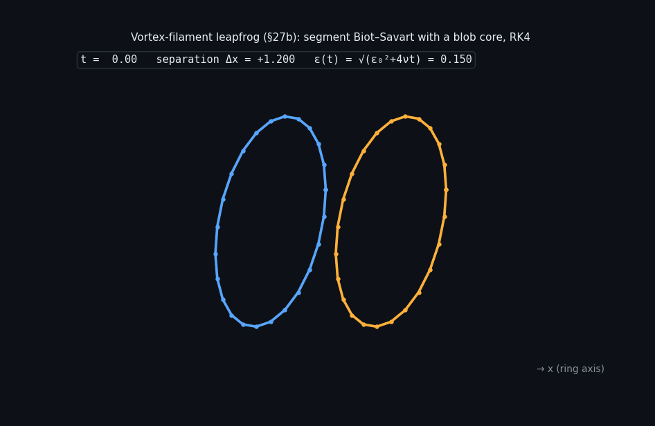
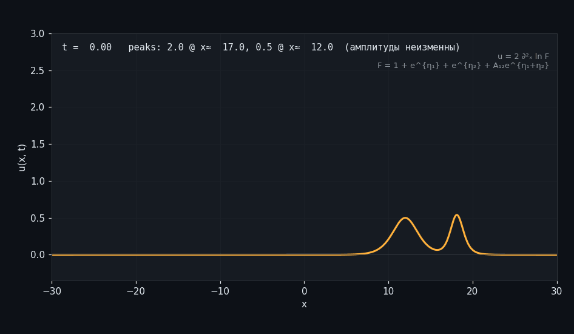
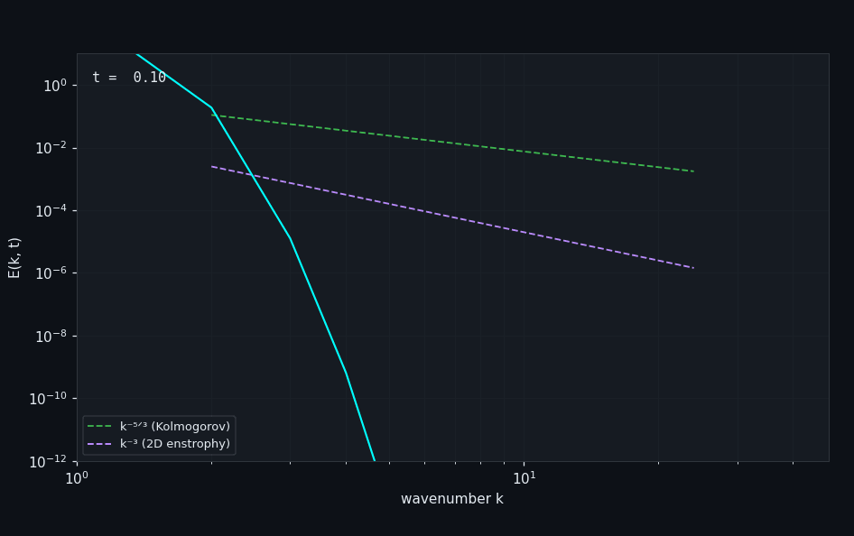
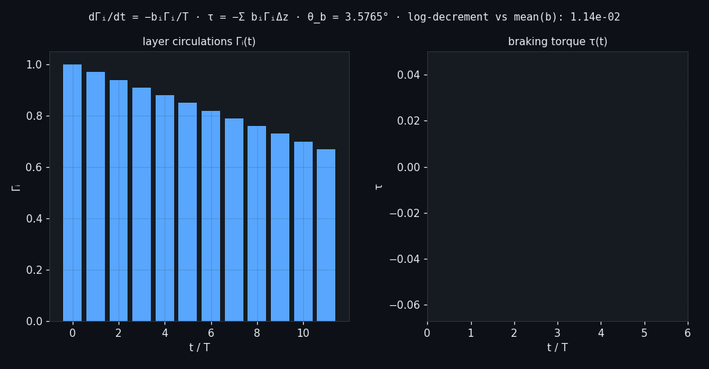
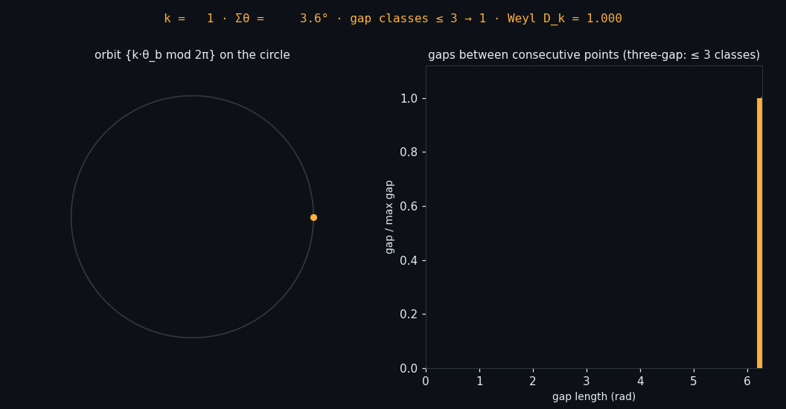

<!-- nsb-brand:v1 -->
<p align="center">
  
</p>

# 🔬 `verification/` — the Verification Framework

> **Navigation:** [repository root](../README.md) › **`verification`**


---

This directory is the **independent verification framework** of the
repository: every headline claim of the research program is re-derived
here from a single shared contract — run a verifier, it prints
per-assertion `[PASS]`/`[FAIL]` lines plus a final `JSON: {…}` verdict,
and exits non-zero on any failure. Three languages with different
foundations do the work: **Lean 4** machine-checks the structural
theorems, **Python** re-derives the numbers from first principles, and
**Julia** re-derives them again through an independent arithmetic path.
On top of the per-topic suites sits a **self-contained monolithic
verifier** (`verify_ns_full.py`, mirrored in Julia) that re-checks the
whole numerical stack in one stdlib-only file, and a **tree auditor**
that walks this directory and confirms its integrity in one
deterministic run. When a proof kernel, two arithmetics and a monolith
that trusts nobody all agree, the residual risk is concentrated where it
belongs — in the modelling, not in the mechanics.

## Contents

1. [What actually lives here](#1-what-actually-lives-here)
2. [The verification contract](#2-the-verification-contract)
3. [The Lean 4 formal core (Tier 1)](#3-the-lean-4-formal-core-tier-1)
4. [The reference chains (Tier 2)](#4-the-reference-chains-tier-2)
5. [The monolithic verifier](#5-the-monolithic-verifier)
6. [The physics runs P1–P6](#6-the-physics-runs-p1p6)
7. [The aggregate runner and the auditors](#7-the-aggregate-runner-and-the-auditors)
8. [Animations — watch the physics](#8-animations--watch-the-physics)
9. [How to run everything](#9-how-to-run-everything)
10. [Provenance snapshots](#10-provenance-snapshots)
11. [Last verified run](#11-last-verified-run)

## 1. What actually lives here

```text
verification/
├── lean4/                      # Tier 1 — the Lean 4 formal core (Mathlib v4.14.0)
│   ├── Foundation.lean         #   the constant b: closed form, 0 < b < 1
│   ├── Basic.lean              #   S1: sin θ_b = b, bounds, Rodrigues algebra
│   ├── BrakingForm.lean        #   braking protocol on modes + γ_eff + VortexTube
│   ├── ProofChain.lean         #   α = √168/2π, L_min, γ = b
│   ├── Soliton.lean / KleinQuartic.lean
│   ├── Tests/AxiomAudit.lean   #   #print axioms of 30 core theorems
│   └── lakefile.lean · lean-toolchain · README.md
├── scripts/                    # Tier 2 — the independent recomputations
│   ├── python_levels/          #   the L1–L5 reference chain (mpmath, numpy)
│   ├── julia_levels/           #   L1–L5 + L7 in Julia (stdlib-only, own FFT)
│   ├── julia_lab/              #   the interactive Julia lab (navier_stokes_lab.jl)
│   └── make_animations.py      #   regenerates assets/animations/*.gif from real solvers
├── common/python/              # the contract-enforcing aggregate runner
├── code/                       # the physics runs P1–P6 (Python) — see code/README.md
│   ├── code/                   #   constants suite, Lean drafts, monolith copies
│   └── verification/           #   historical snapshot (byte-identical) — see §10
├── tests/                      # pytest: Lean-core structure + numerical consistency
├── tools/audit/                # audit_lean.py + verify_repo.py (whole-tree auditor)
├── verify_ns_full.py           # the self-contained verifier, 22 tasks (Python)
├── verify_ns_full.jl           # the same contract in Julia
├── verify_ns_full_codes.zip    # archive of both monoliths
├── Makefile · CODEOWNERS · README.md
```

| Component | Language | Role | Entry point |
|---|---|---|---|
| [`lean4/`](lean4/README.md) | Lean 4 + Mathlib | machine-checked theorems: 72 `theorem`s, 0 `sorry`, 0 project axioms | `lake build` · `lake env lean Tests/AxiomAudit.lean` |
| [`scripts/python_levels/`](scripts/README.md) | Python | **L1–L5 reference chain** — the executable definition of the levels | `verify_all.py` |
| [`scripts/julia_levels/`](scripts/README.md) | Julia | L1–L5 + L7 through an independent arithmetic path | `julia verify_all.jl` |
| [`scripts/julia_lab/`](scripts/README.md) | Julia | interactive laboratory app (solvers, diagnostics, reports) | `./run.sh` |
| [`scripts/make_animations.py`](scripts/README.md) | Python | regenerates every GIF in [`assets/animations/`](../assets/animations/README.md) | `python3 make_animations.py` |
| [`scripts/make_charts.py`](scripts/README.md) | Python | regenerates the verification charts (coverage matrix ×2, CI gates, P1–P7) from live JSON/Lean sources | `python3 make_charts.py` |
| [`common/python/`](common/README.md) | Python | aggregate runner enforcing the output contract | `main.py --all` |
| [`code/`](code/README.md) | Python | physics runs **P1–P6** (microphysics, convergence, buoyancy, ensemble, droplets, universality) | `run_all.sh` |
| [`verify_ns_full.py`](verify_ns_full.py) | Python | the 22-task monolith + TUI/CLI + own PNG/GIF/SVG/PDF renderer | `--ci` · `--task N` · `--menu` |
| [`tests/`](tests/README.md) | pytest | fast cross-layer consistency tests (12 tests, seconds) | `make test` |
| [`tools/audit/`](tools/audit/README.md) | Python | the whole-tree auditor (5 evidence groups) | `make verify-repo` |

## 2. The verification contract

Every computational suite in this framework follows one output contract:

```text
banner → per-assertion [PASS]/[FAIL] lines → one JSON: {...} verdict → exit code
```

exit `0` only if every assertion passed. The contract is what makes the
layers chainable: the aggregate runner (`common/python/main.py`) executes
each suite as a subprocess and forwards its verdict; CI asserts exit
codes; nothing parses prose. The formal tier mirrors the contract with
*lemma names* instead of `[PASS]` lines, and its trust base is
enumerable — `Tests/AxiomAudit.lean` prints the axiom dependencies of 30
core theorems and the auditors check they are only the standard
`propext / Quot.sound / Classical.choice`.

## 3. The Lean 4 formal core (Tier 1)

The package (`NsbCore`, defined in [`lean4/lakefile.lean`](lean4/lakefile.lean))
is six modules over Mathlib v4.14.0:

| Module | Content |
|---|---|
| `Foundation.lean` | the constant `bCorrection = π/(4π² + 2π√3)`, positivity, `b < 1` |
| `Basic.lean` (S1) | `0.062 < b < 0.063`, `sin θ_b = b`, the Rodrigues rotation algebra: `RᵀR = I`, `det R = 1`, norm preservation |
| `BrakingForm.lean` | the braking protocol on Leray modes (div-free steps, iterated superposition, BKM factor), the γ_eff limit theorems, the vortex-tube identities (`sin θ_b` equals the Kirchhoff value) |
| `ProofChain.lean` (S2) | `α = √168/(2π)`, `L_min = 2π/√168`, `γ = α·b·L_min = b`, analytic bounds |
| `Soliton.lean` (S4) | the KdV soliton `u = (c/2)·sech²(√c(x−ct)/2)` — defined explicitly; the ODE substitution is **not** formalized yet and the module says so honestly |
| `KleinQuartic.lean` (S5) | the Klein polynomial, box-counting dimension `ln 168/ln 7`, the bridge implication |

Static audit (run it yourself: `make audit`): **files 9, theorems 72,
defs 36, project axioms 0, sorries 0, bad imports 0.** 

## 4. The reference chains (Tier 2)

**Python — [`scripts/python_levels/`](scripts/python_levels/README.md)**,
the reference implementation every other layer must agree with:

| Level | Establishes | Recorded outcome (this tree, 2026-11-11) |
|---|---|---|
| **L1** | exact constants from the closed forms (mpmath, 50 digits) | 13/13 checks PASS |
| **L2** | rotation algebra `RᵀR = I`, `\|u′\| = \|u\|` | residual **4.44e-16** |
| **L3** | Kirchhoff point vortices: Hamiltonicity, RK4 order | order **4.00**, isometry 2.91e-11 |
| **L4** | 2D NSE: `ω′ = cos θ_b·ω`, energy balance | residual 7.11e-14, `\|ΔE\|` 3.90e-09 |
| **L5** | 3D Taylor–Green BKM protocol (N = 48, ν = 0.01, T = 6) | `NSE3D_SKIP=1` skips; ~10–20 min when run |

L1–L4 complete in **~8 seconds**. **Julia —
[`scripts/julia_levels/`](scripts/julia_levels/README.md)** re-implements
L1–L5 plus the Smagorinsky–Kolmogorov master relation as **L7**, stdlib
only with its own radix-2 FFT — an independent arithmetic path (LLVM
`Float64`) that must land inside the same tolerances.

## 5. The monolithic verifier

[`verify_ns_full.py`](verify_ns_full.py) (~7.4k lines) and its Julia twin
[`verify_ns_full.jl`](verify_ns_full.jl) are **self-contained**: standard
library only, zero codegen, zero network, quiet on import. One file
re-derives the whole numerical stack — the constant chain at Decimal
55/65 digits, the master relation at 50 digits, the Cassini identity in
exact Fibonacci integers, the KdV soliton residual, the Klein bridge,
the Rodrigues algebra, Kirchhoff RK4 Hamiltonicity, the layered 3D
b-correction (§27), vortex filaments with a blob core (§27b), and seven
exact NS solutions as benchmarks (§31). It renders its own PNG/GIF/SVG
artifacts with a hand-written vector stroke renderer — no plotting
libraries.

<details>
<summary><b>The 22 tasks (click to expand)</b></summary>

| # | slug | verifies | two-pass |
|---|---|---|---|
| 1 | `constants` | b → θ_b → Klein closure, Decimal 55/65 digits | yes |
| 2 | `smagorinsky` | C_s = 1/(π(3C_K/2)^{3/4}) pinned 50 digits, exponent law, K41 | yes |
| 3 | `cassini` | Cassini identity + (5′) coefficients, exact Fibonacci integers | yes |
| 4 | `kdv` | travelling-wave substitution, analytic sech² derivatives | yes |
| 5 | `klein_bridge` | Niven irrationality, three-gap filling, isometry | yes |
| 6 | `rodrigues` | RᵀR = I, det, norm, spectrum-angle | yes |
| 7 | `kirchhoff` | RK4 Hamiltonicity: drift ~dt⁴, order 4, isometry | yes |
| 8 | `py_bridge` | cross-check against the Julia run's verdicts (skips if absent) | no |
| 9 | `pinned` | b and C_s(1.5) against string references on Float64 | no |
| 10 | `suite` | consolidated run of tasks 1–4 | no |
| 11 | `layered_b` | b(h, W), limits, monotonicity (§27) | no |
| 12 | `layer_sync` | Kirchhoff↔Rodrigues sync per layer | no |
| 13 | `total_braking` | τ = −Σ b_iΓ_i with Δz weights, N-convergence | no |
| 14 | `layered_evolution` | dΓ/dt = −bΓ/T, log-decrement vs mean(b) | no |
| 15 | `dynamic` | fuzz + sweep + metamorphic | no |
| 16 | `taylor_green` | discrete NS residual < 3h², Richardson order ≈ 2 (measured **1.93**) | no |
| 17 | `kovasznay` | steady NS solution, Re = 30, order ≈ 2 (measured **1.96**) | no |
| 18 | `stokes_wall` | Stokes II against e^{−ky}sin(ωt−ky), periodicity | no |
| 19 | `leray_energy` | E = π²e^{−4νt} (err **1.8e-15**), Leray–Hopf monotonicity | no |
| 20 | `abc_beltrami` | Beltrami property, Lamb identity (3.4e-15) | no |
| 21 | `burgers_shock` | stationary shock −tanh(cx/2ν) | no |
| 22 | `richardson` | consolidated orders: TG p = [1.960, 1.974], ABC p = [1.985, 1.996] | no |

plus a bonus mode: `--vortex N` renders a 3D vortex-filament animation
(GIF) with a stabilization report.
</details>

Modes: `--ci` (tasks 1–15, two-pass, ~100 s), `--task 1,5,9` (any
subset), `--task all`, an interactive TUI menu in a TTY, `--list-tasks`,
and a JSON event log. Run directories land in `results/`
(git-ignored).

## 6. The physics runs P1–P6

[`code/`](code/README.md) holds the executable physics of the program:
droplet microphysics against analytics (**P1**), grid/time convergence
(**P2**), Rayleigh–Bénard buoyancy at Gr = 10⁶ (**P3**), ensemble spread
(**P4**), two-way droplet–flow feedback (**P5**), and universality of
θ_b on R², T², S², H², R³ (**P6**). Every run writes a JSON protocol —
command, parameters, tolerances, wall-clock — and the figures are
regenerated *from those protocols* by `make_plots.py`. The same P3
equations power the Rayleigh–Bénard animation below.

## 7. The aggregate runner and the auditors

- [`common/python/main.py`](common/README.md) runs the four suites
  (`levels`, `monolith`, `code`, `audit`) under presets and enforces the
  contract. `--all` (quick preset) finishes in ~30 s and is what CI
  smoke-runs.
- [`tools/audit/verify_repo.py`](tools/audit/README.md) re-derives the
  integrity of this whole tree in five evidence groups — structure,
  trust base, Lean core, a live L1–L4 run, Makefile hygiene — and exits
  non-zero on any drift. It is the "nobody updated the docs" tripwire:
  rename a module without updating its count and `make verify-repo`
  goes red.
- [`tests/`](tests/README.md) binds the layers with 12 fast pytest tests
  (Lean structure + numerical consistency), run by CI on every push.

## 8. Animations — watch the physics

Every GIF is regenerated by [`scripts/make_animations.py`](scripts/make_animations.py)
from a real solver or an exact closed form — deterministic seeds, no
stock footage. The full annotated set lives in
[`assets/animations/`](../assets/animations/README.md).

<p align="center">
  
  
</p>
<p align="center">
  
  
</p>
<p align="center">
  
  
  
  
</p>

| Animation | Produced by |
|---|---|
| `anim_b_rotation` | the exact Rodrigues form, 40 steps of θ_b, ‖u′‖ = ‖u‖ at every step (2.2e-16) |
| `anim_taylor_green` | the repository's own `code/tg2d_core.py` pseudo-spectral solver (N = 96, ν = 10⁻³, RK4, 2/3-dealiasing, Leray) |
| `anim_rayleigh_benard` | the registered P3 equations (ψ–ω Boussinesq, Nz = 144, dt = 1.5e-6): Nu_hot = 8.29, CFL ≤ 0.187 |
| `anim_vortex_filaments` | segment Biot–Savart with blob core ε² = ε₀²+4νt, RK4, ring leapfrog (§27b) |
| `anim_kdv_collision` | the exact Hirota two-soliton `u = 2 ∂²ₓ ln F` |
| `anim_spectrum_cascade` | shell spectrum E(k, t) of the same tg2d_core run vs k⁻⁵ᐟ³ and k⁻³ |
| `anim_layered_braking` | exact solution of dΓᵢ/dt = −bᵢΓᵢ/T with τ = −Σ bᵢΓᵢΔz (§27) |
| `anim_klein_orbit` | the Klein bridge: uniform filling by the rotation θ_b, three-gap classes, Weyl D_k — monolith task 5 |

## 9. How to run everything

```bash
# from the repository root
make -C verification verify-levels     # L1–L4 in ~8 s (add FAST= to include L5)
make -C verification verify-monolith   # the monolith, CI preset (~100 s)
make -C verification verify-code       # exact constants + Lean audit (~1 s)
make -C verification verify-common     # the aggregate runner over all suites
make -C verification test              # the 12 pytest consistency tests
make -C verification verify-repo       # the whole-tree auditor (5 groups)
make -C verification audit             # the static Lean audit

make verify-repo                       # the same targets exist in the root Makefile
python3 verification/scripts/make_animations.py   # regenerate all 8 GIFs (~2 min)
python3 verification/scripts/make_charts.py       # regenerate the verification charts (~2 s)
```

Timings above are from two vCPU cores. Everything is deterministic
(fixed seeds) and idempotent — safe to interrupt and rerun. The Lean
core additionally builds with `lake` when the toolchain is installed
(`make -C verification verify-lean` exits with instructions if it is
not).

## 10. Provenance snapshots

Two historical snapshots are kept deliberately, byte-identical to their
canonical copies (verified by sha256 at snapshot time, re-verify with
`diff -rq`):

| Snapshot | Canonical copy |
|---|---|
| `code/verification/python_levels/` | `scripts/python_levels/` |
| `code/verification/julia_levels/` | `scripts/julia_levels/` |
| `code/verification/julia_lab/` | `scripts/julia_lab/` |
| `code/verification/lean4/` | `lean4/` (which additionally carries `lean-toolchain` and the repaired import graph) |
| `code/verification/code/` | `code/` (P1–P6) |
| `code/code/verify_ns_full.py` · `.jl` | `verify_ns_full.py` · `.jl` |

The snapshot preserves the pre-restructuring layout of the framework
(the era of the eleven-language matrix). It is **not** executed by any
Makefile, CI job or auditor; the auditors skip it explicitly. A future
cleanup may delete it — nothing depends on it.

## 11. Last verified run

| Check | Result | When |
|---|---|---|
| `verify_ns_full.py --ci` (tasks 1–15, two-pass) | **PASS**, exit 0 | 2026-11-11 |
| `verify_ns_full.py --task 16..22` (exact NS benchmarks) | **PASS**, exit 0 | 2026-11-11 |
| `python_levels/verify_all.py` (NSE3D_SKIP=1) | L1–L4 **PASS** in 8 s | 2026-11-11 |
| `code/code/verify_all.py` | 13 + 13 checks **PASS** | 2026-11-11 |
| `tools/audit/audit_lean.py` | 72 theorems, 0 sorry, 0 bad imports | 2026-11-11 |
| `tools/audit/verify_repo.py` | 5/5 groups **PASS** | 2026-11-11 |
| `pytest verification/tests/` | 12 passed, 1 skipped (no lake) | 2026-11-11 |
| `make_animations.py` | 7/7 GIFs **PASS** | 2026-11-11 |

## License

Part of **navier-stokes-b**, license IPL-RP-1.0. ([LICENSE.md](../LICENSE.md)).
