<!-- nsb-brand:v1 -->

  

# ⚠️ `code/verification/` — historical provenance snapshot (read-only)

> **Navigation:** [repository root](../../../README.md) › [verification](../../README.md) › [code](../README.md) › **`verification` (snapshot)**

---

**This directory is a frozen byte-level snapshot of the verification
framework as it looked *before* the restructuring**, preserved inside
`code/` for provenance. It is not the framework. Do not run it, do not
link to it from new documentation, do not expect its READMEs (kept
verbatim, describing the historical eleven-language layout) to match
the current tree.

What is inside, and where the live copy lives:

| Snapshot path | Canonical (live) copy |
|---|---|
| [`python_levels/`](python_levels/README.md) | [`verification/scripts/python_levels/`](../../scripts/python_levels/README.md) |
| [`julia_levels/`](julia_levels/README.md) | [`verification/scripts/julia_levels/`](../../scripts/julia_levels/README.md) |
| [`julia_lab/`](julia_lab/README.md) | [`verification/scripts/julia_lab/`](../../scripts/julia_lab/README.md) |
| [`lean4/`](lean4/README.md) | [`verification/lean4/`](../../lean4/README.md) (which additionally carries `lean-toolchain` and the repaired import graph) |
| [`code/`](code/README.md) | [`verification/code/`](../README.md) (P1–P6) |

Every pair was byte-identical at snapshot time; re-verify with
`diff -rq verification/code/verification/python_levels verification/scripts/python_levels`
and its siblings. The snapshot's own `README.md` files — including the
eleven-language framework hub copy one level up in this directory —
describe the *pre-restructuring era* (Coq/Isabelle/Agda, C++/Rust/Haskell
ports, sections 1–7) that was subsequently removed from the live tree.

Nothing in the Makefiles, CI workflows or auditors executes anything
here; the tree auditor skips this directory explicitly. A future
cleanup may delete the whole snapshot — nothing depends on it.

## License

Part of **navier-stokes-b**, license IPL-RP-1.0. ([LICENSE.md](../../../LICENSE.md)).
