<!-- nsb-brand:v1 -->
<p align="center">
  
</p>

# `common/` — the contract-enforcing aggregate runner

> **Navigation:** [repository root](../../README.md) › [verification](../README.md) › **`common`**


---

This directory holds the runner that executes every verification suite
of the framework uniformly and enforces the repository-wide output
contract. The design rule is deliberately conservative: **the runner
never imports suite code** — every suite is launched as a subprocess, so
a crash, a hang or a missing interpreter becomes a verdict, not an
exception inside the runner. Suites stay independently runnable;
the runner only knows how to start them, relay their
`[PASS]`/`[FAIL]` lines, require a `JSON: {…}` verdict and turn
failures into a non-zero exit (the CI hook).

## What lives here

| Path | Role |
|---|---|
| [`python/main.py`](python/README.md) | the aggregate runner: `--suite levels,monolith` / `--all` / `--list`, presets, timeout guard, verdict forwarding |
| [`python/config.py`](python/README.md) | the suite registry (the four suites that actually exist) and the preset table (`quick` / `default` / `full`) |
| [`python/verifier_base.py`](python/README.md) | the base class used by tooling that builds on the contract |
| [`python/__init__.py`](python/README.md) | package marker |

## The suites

| Suite | Command executed | Preset effect |
|---|---|---|
| `levels` | `scripts/python_levels/verify_all.py` | `quick`/`default` set `NSE3D_SKIP=1`; `full` runs L5 (~10–20 min) |
| `monolith` | `verify_ns_full.py` | `quick`: `--task 9`; `default`/`full`: `--ci` (~100 s) |
| `code` | `code/code/exact_constants.py` | — |
| `audit` | `tools/audit/audit_lean.py` | — |

## Run

```bash
# one suite through the uniform harness
python3 verification/common/python/main.py --suite levels --preset default

# every suite, quick preset (~30 s) — what CI smoke-runs
python3 verification/common/python/main.py --all

# the registry
python3 verification/common/python/main.py --list
```

The final line is always one aggregate `JSON: {"suites": {...},
"all_passed": bool}` verdict; the exit code is `0` only when every
suite passed, which is what `make verify-common` and the
`verification-smoke` CI job assert.

## License

Part of **navier-stokes-b**, license IPL-RP-1.0. ([LICENSE.md](../../LICENSE.md)).
