<!-- nsb-brand:v1 -->
<p align="center">
  
</p>

# `common/python/` — the runner, the registry, the base class

> **Navigation:** [repository root](../../README.md) › [verification](../../README.md) › [common](../README.md) › **`python/`**

  

---

## `main.py` — the aggregate runner

Runs each registered suite as a **subprocess** (never an import — a
crash becomes a verdict, not a traceback in the runner) and enforces the
repository-wide contract:

```text
banner  →  [PASS]/[FAIL] per assertion  →  JSON: {...}  →  exit 0 iff all passed
```

Usage:

```bash
python main.py --suite levels --preset default   # one suite
python main.py --suite levels,monolith           # several suites
python main.py --all                             # every suite, quick preset
python main.py --list                            # the registry as TSV
```

The last line is always an aggregate `JSON: {"suites": {...},
"all_passed": …}` verdict.

## `config.py` — registry and presets

The registry maps suite names onto commands that exist in this
repository (`scripts/python_levels/verify_all.py`, `verify_ns_full.py`,
`code/code/exact_constants.py`, `tools/audit/audit_lean.py`); the
auditor `tools/audit/verify_repo.py` fails if a registered command
drifts away from the tree.

| Preset | `levels` | `monolith` |
|---|---|---|
| `quick` | `NSE3D_SKIP=1` | `--task 9` |
| `default` | `NSE3D_SKIP=1` | `--ci` |
| `full` | L5 included (~10–20 min) | `--ci` |

## `verifier_base.py`

The small base class used by tooling that builds on the contract to
parse a suite's verdict line without re-implementing the contract.

## License

Part of **navier-stokes-b**, license IPL-RP-1.0. ([LICENSE.md](../../../LICENSE.md)).
