<!-- nsb-brand:v1 -->
<p align="center">
  
</p>

# `lean4/` — the Lean 4 formal core

> **Navigation:** [repository root](../../README.md) › [verification](../README.md) › **`lean4`**


---

Lean 4 is the formal tier of the verification framework: the structural
facts behind the b-correction program are stated as named theorems and
machine-checked against Mathlib. The package `NsbCore` (defined in
[`lakefile.lean`](lakefile.lean)) is six modules; the trust base is
honest and enumerable — there are **no `sorry`s, no `admit`s and no
project axioms** anywhere in the core, and the axiom dependencies of 30
central theorems are printed in
[`Tests/AxiomAudit.lean`](Tests/AxiomAudit.lean) so a reviewer can see
the full dependency set (only `propext`, `Quot.sound`,
`Classical.choice`) with one command.

Where a statement is *not* formalized, the module says so in a comment
instead of faking it — the empty placeholder axioms that once existed
were removed on 2026-11-07, together with the theorems that depended on
them. What remains is exactly what the kernel checked.

## Build

```bash
cd verification/lean4
lake build                              # type-check every module
lake env lean Tests/AxiomAudit.lean     # print the axiom bases (30 theorems)
lake exe check                          # the runtime banner + theorem count
```

Toolchain: Lean `v4.14.0` ([lean-toolchain](lean-toolchain)), Mathlib
pinned to `v4.14.0`. Install [elan](https://leanprover.github.io/lean4)
first; without it every `lake`-dependent check in this repository skips
honestly instead of pretending.

## Module map

| Module | Theorems | Content |
|---|---|---|
| [`Foundation.lean`](Foundation.lean) | 2 | the constant `bCorrection = π/(4π² + 2π√3) = 1/(4π + 2√3)`: positivity and `b < 1` (namespace `Nsb`) |
| [`Basic.lean`](Basic.lean) (S1) | 16 | `0.062 < b < 0.063`, `sin θ_b = b`, and the Rodrigues rotation algebra: `rodrigues_orthogonal`, `R_b_orthogonal`, `R_b_det_one`, `R_b_preserves_norm` |
| [`BrakingForm.lean`](BrakingForm.lean) | 47 | three namespaces: **`Braking2D`** — the braking protocol on Leray modes (div-free single step, iterated superposition, energy bounds, the BKM factor); **`Protocol`** — the protocol ODE form and the γ_eff limit theorems (`sin x/x`, `ln cos`, `γ_eff → b`); **`VortexTube`** — the vortex-tube identities, `sin θ_b` equals the Kirchhoff value |
| [`ProofChain.lean`](ProofChain.lean) (S2) | 6 | `α = √168/(2π)`, `L_min = 2π/√168 = 1/α`, `γ = α·b·L_min = b`, analytic bounds `2 < α < 2.1`, `L_min < 1` |
| [`Soliton.lean`](Soliton.lean) (S4) | 0 | the KdV soliton `u = (c/2)·sech²(√c(x−ct)/2)` defined explicitly (`sechR`); the ODE substitution and the Miura map are **not** formalized — stated openly in the module |
| [`KleinQuartic.lean`](KleinQuartic.lean) (S5) | 1 | the Klein polynomial `x³y + y³z + z³x`, box-counting dimension `ln 168/ln 7`, and `klein_bridge_implies_nse_regularity` |

Auxiliary files: [`Main.lean`](Main.lean) (the `check` executable —
prints the module list and `totalVerifiedTheorems = 72`, a count the
pytest suite re-derives from the sources), and
[`braking_symbolic_check.py`](braking_symbolic_check.py), a stdlib-only
symbolic spot-check of the braking-form algebra.

## The trust base, mechanically

```bash
$ lake env lean Tests/AxiomAudit.lean
```

Each of the 30 `#print axioms` lines reports the axiom dependencies of
one theorem. The allowed set is `{propext, Quot.sound,
Classical.choice, Lean.ofReduceBool}` — everything else is a red flag.
The check runs automatically inside `verification/tests/test_lean_core.py`
when `lake` is available (it parses the output and fails on any axiom
outside the allowed set), and the static part (counts, imports, no-sorry)
always runs via [`tools/audit/audit_lean.py`](../tools/audit/README.md)
and `make audit` — no toolchain required.

## License

Part of **navier-stokes-b**, license IPL-RP-1.0. ([LICENSE.md](../../LICENSE.md)).
