<!-- nsb-brand:v1 -->
<p align="center">
  
</p>

# `scripts/` — the recomputation suites and the animation factory

> **Navigation:** [repository root](../../README.md) › [verification](../README.md) › **`scripts`**


---

Four independent sub-packages, one rule: everything here re-derives the
program's claims from first principles and follows the shared output
contract (`banner → [PASS]/[FAIL] → JSON → exit code`).

| Directory | What it is | Entry point |
|---|---|---|
| [`python_levels/`](python_levels/README.md) | **the L1–L5 reference chain** — the executable definition of the five verification levels (mpmath at 50 digits, pseudo-spectral 2D NSE, the 3D BKM protocol) | `python3 python_levels/verify_all.py` |
| [`julia_levels/`](julia_levels/README.md) | the same chain re-implemented **independently in Julia** (L1–L5 + the Smagorinsky–Kolmogorov master relation as L7), stdlib-only with its own radix-2 FFT | `julia julia_levels/verify_all.jl` |
| [`julia_lab/`](julia_lab/README.md) | the interactive Julia laboratory app: solvers, diagnostics, blow-up hunts, EN/RU reports (details in [`DOCS_RU.md`](julia_lab/DOCS_RU.md)) | `./julia_lab/run.sh` |
| [`make_animations.py`](make_animations.py) | the GIF factory — regenerates every animation in [`assets/animations/`](../../assets/animations/README.md) from real solvers and exact closed forms | `python3 make_animations.py --list` |
| [`make_charts.py`](make_charts.py) | the chart factory — the verification-coverage matrix (dark + light editions), the seven CI gates and the P1–P7 outcome chart; every value read from `data/results/*.json` and the lean4/ sources | `python3 make_charts.py` |

## `make_animations.py`

One command rebuilds the whole moving-figure layer of the repository
(~2 min, deterministic seeds, self-checking: frame counts, file sizes
and a non-blank-pixel assertion per GIF, `JSON: {…}` verdict at the end):

```bash
python3 verification/scripts/make_animations.py             # all 8 GIFs
python3 verification/scripts/make_animations.py --only taylor_green
python3 verification/scripts/make_animations.py --outdir /tmp/anim
```

The animations import the repository's own physics cores —
`code/tg2d_core.py` (pseudo-spectral Taylor–Green) and
`code/p3_buoyancy.py` (the registered P3 Rayleigh–Bénard protocol, run
at its published Nz = 144, dt = 1.5·10⁻⁶) — so what you can watch is
what the verifiers check. Requires the scientific stack from
[`environment.yml`](../../environment.yml) (numpy, matplotlib, Pillow).

## License

Part of **navier-stokes-b**, license IPL-RP-1.0. ([LICENSE.md](../../LICENSE.md)).
